# pgmcd

Zero-dependency C11 Siamese Contrastive (Symmetric InfoNCE / Cosine Distance) engine for self-supervised satellite & SAR image change detection on Netpbm PGM (`P5`/`P2`, 8-bit & 16-bit) imagery.

## Build

```sh
cc -O3 -march=native -Wall -Wextra -Wno-unknown-pragmas pgmcd.c -lm -o pgmcd
```

## Usage

### 1. Train (`-t`)
Train across multiple `<pre.pgm> <post.pgm>` pairs via positional arguments, `-L <list.txt>`, or streamed from `stdin` (`-`):

```sh
paste <(find pgm_s1 -name '*_pre.pgm' | sort | head -n 1000) \
      <(find pgm_s1 -name '*_post.pgm' | sort | head -n 1000) \
  | ./pgmcd -t -w s1_b2.w -n 10000 -
```

### 2. Evaluate (`-e`)
Compute label-free Matched vs. Mismatched Tile ROC-AUC across held-out image pairs:

```sh
paste <(find pgm_s1 -name '*_pre.pgm' | sort | sed -n '1501,1600p') \
      <(find pgm_s1 -name '*_post.pgm' | sort | sed -n '1501,1600p') \
  | ./pgmcd -e -w s1_b2.w -
```

```text
pgmcd: evaluated 100 pairs (16900 tiles, stride=8, thresh=0.35)
  matched    (pre_i, post_i): mean=0.1166 med=0.1111 p95=0.2126 alerts=0/100 (0.0%)
  mismatched (pre_i, post_j): mean=0.2178 med=0.2123 p95=0.3360 alerts=20/100 (20.0%)
  separation gap:             +0.1012
  tile ROC-AUC:               0.8833
```

### 3. Inference & Alerting
Follows POSIX `diff(1)` / `cmp(1)` exit conventions (`0` = normal, `1` = anomaly alert triggered, `2` = error):

```sh
./pgmcd -w s1_b2.w -a 0.35 -f 0.05 pre.pgm post.pgm > change_map.pgm || notify_alert
```

---

## Held-Out Sentinel-1 SAR Alert Examples

Each 3-panel figure shows **Pre-Disaster Sentinel-1 SAR** (left, false-color `VV`/`VH`/`VV−VH`), **Post-Disaster Sentinel-1 SAR** (center), and the **$13\times13$ `pgmcd` Cosine-Distance Change Map** (right, with anomalous tiles $\ge 0.35$ highlighted in red/orange):

### `hurricane-matthew_00000003`
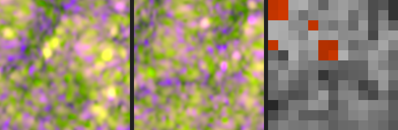

### `hurricane-matthew_00000009`
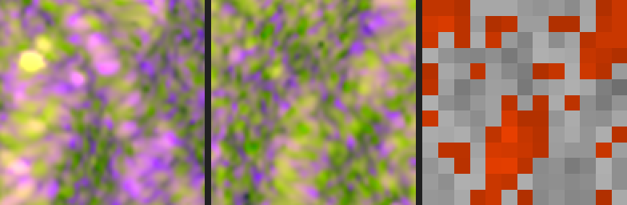

### `hurricane-matthew_00000026`
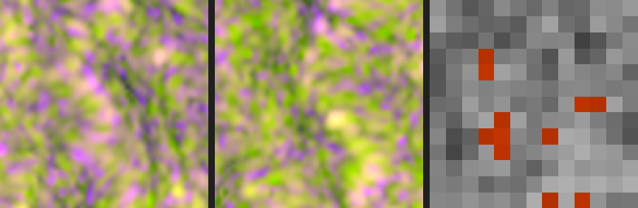

### `hurricane-matthew_00000033`
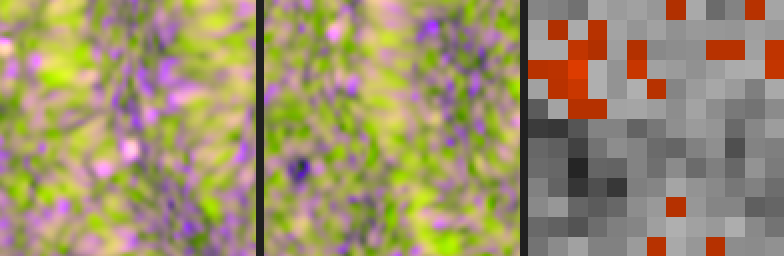

### `hurricane-matthew_00000036`
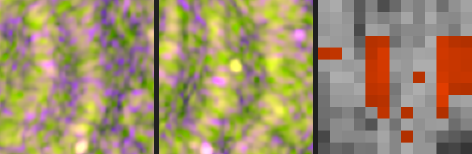

### `hurricane-matthew_00000040`
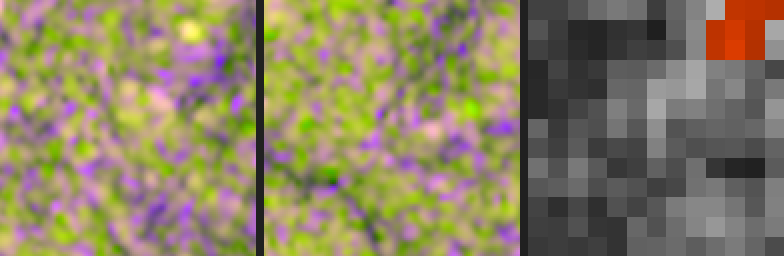

### `hurricane-matthew_00000094`
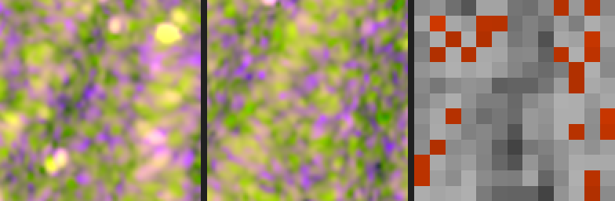

### `hurricane-matthew_00000099`
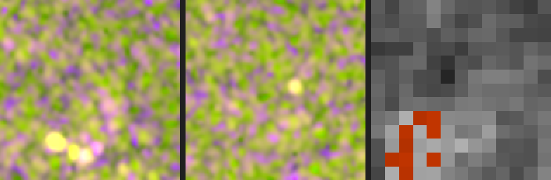

### `hurricane-matthew_00000304`
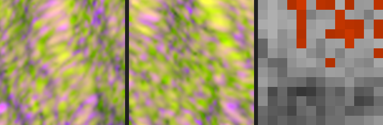

### `hurricane-matthew_00000308`
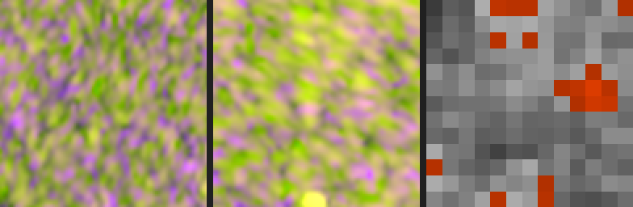

### `hurricane-matthew_00000350`
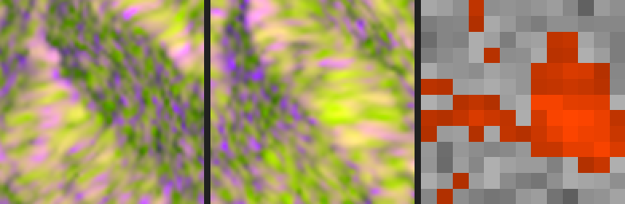

### `hurricane-matthew_00000356`
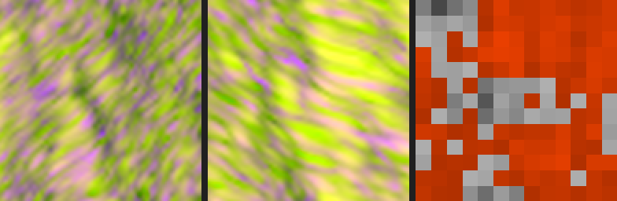

### `hurricane-matthew_00000362`
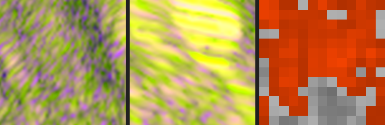

### `hurricane-matthew_00000364`
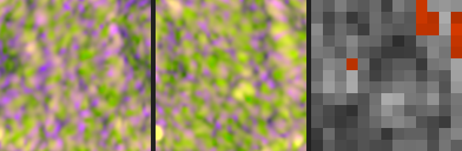

### `hurricane-matthew_00000365`
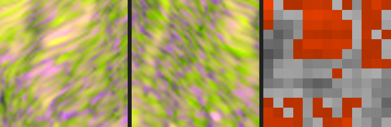

### `hurricane-matthew_00000370`
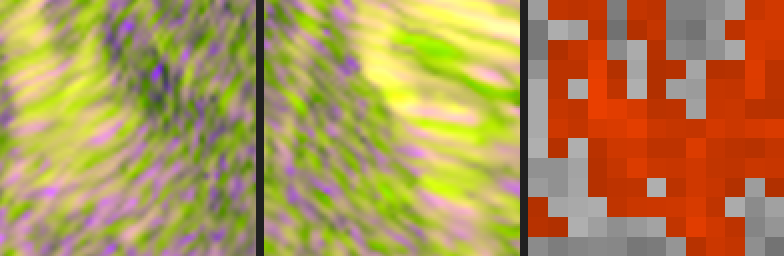
