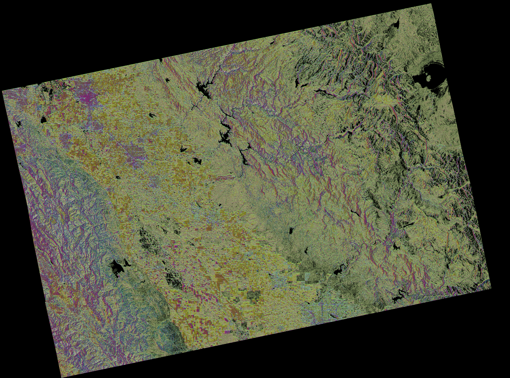
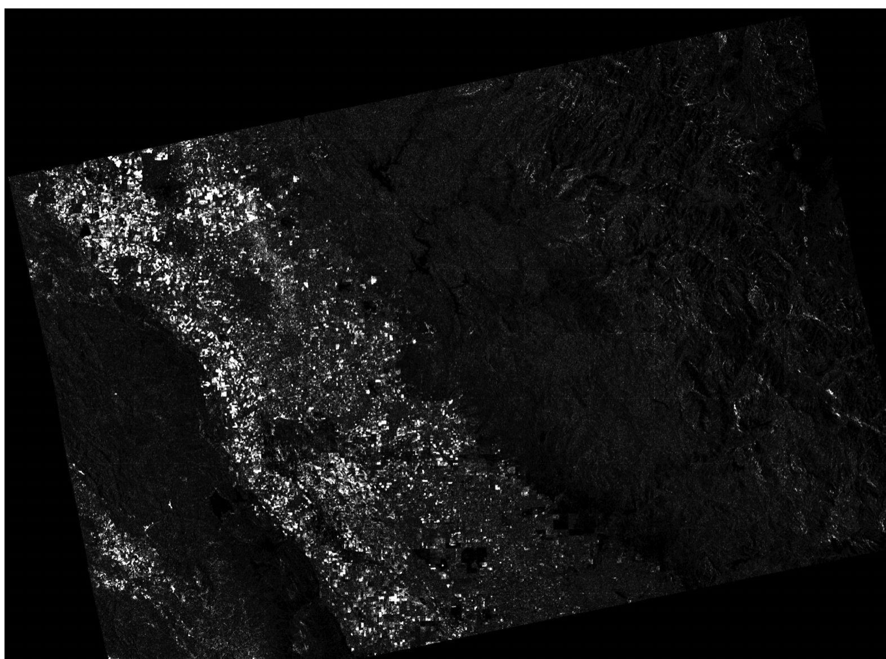
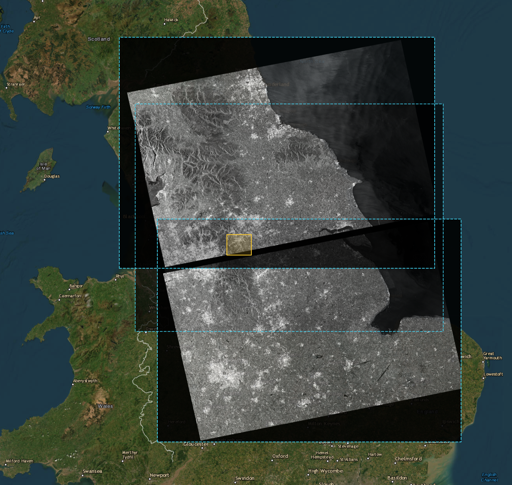

# siam

Zero-dependency C++17 Siamese Barlow Twins engine for self-supervised satellite & SAR image change detection on Netpbm PGM (`P5`/`P2`, 8-bit & 16-bit) imagery.

## Build

```sh
make          # single-threaded
make OMP=1    # multi-threaded (OpenMP)
```

Or compile directly:

```sh
g++ -std=c++17 -O3 -march=native -Wall -Wextra -Wno-unknown-pragmas main.cpp -lm -o bin/siam
```

## Usage

The command-line reference is also available with `./bin/siam -h`:

```text
NAME
    siam - train and run a Siamese image-change detector

SYNOPSIS
    siam [options] PRE POST
    siam -M STATE [options] FRAME
    siam -t [options] [PRE POST]...
    siam -e [options] [PRE POST]...
    siam -h

DESCRIPTION
    PRE and POST are P2 or P5 PGM images (8-bit or 16-bit) with matching
    dimensions of at least 32x32 pixels. Training and evaluation accept
    image pairs as operands, from a pair list (-L FILE), or from standard
    input (-). Each pair-list entry is PRE POST. With `-M`, `FRAME` is one
    current image scored against and added to the saved temporal state.

OPTIONS
    -h              display help and exit
    -t              train
    -e              evaluate matched and mismatched pairs (at least 2 pairs)
    -C              calibrate threshold on baseline/historical pairs
    -c              continue training from saved weights
    -q              suppress training progress and inference status
    -u              upsample the inference map to input dimensions
    -w FILE         weights file [siam.w]
    -L FILE         read image pairs from FILE; '-' means standard input
    -o FILE         write output map or calibrated threshold to FILE; '-' means stdout
    -v FILE         write POST tile embeddings as a PCA false-color P6 PPM; '-' means stdout
    -D FILE         write anomalous backscatter-drop tiles to FILE
    -I FILE         write anomalous backscatter-increase tiles to FILE
    -n STEPS        training steps [200]
    -l RATE         learning rate [0.01]
    -S SEED         random seed [time and process ID]
    -a VALUE        tile distance threshold [0.35]
    -f VALUE        alert fraction / calibration target P_fa [0.05]
    -s PIXELS       sliding-window stride [8]
    -T VALUE        temporal stability threshold for positive training patches [0.20]

EXIT STATUS
    0   normal result or successful training/evaluation
    1   anomaly alert
    2   invalid arguments or I/O/runtime error

EXAMPLES
    siam -w siam.w -o change.pgm before.pgm after.pgm
    siam -w siam.w -o change.pgm -v embedding.ppm before.pgm after.pgm
    siam -w siam.w -o change.pgm -D drop.pgm -I increase.pgm before.pgm after.pgm
    siam -t -w siam.w -n 200 -L train_pairs.txt
    siam -e -w siam.w -L heldout_pairs.txt
    siam -C -w siam.w -L calib_pairs.txt -f 0.005 -o calib_thresh.txt
```

### 1. Train (`-t`)
Train with a Barlow Twins cross-correlation objective across multiple
`<pre.pgm> <post.pgm>` pairs via positional arguments, `-L <list.txt>`, or
streamed from `stdin` (`-`):

For each batch of paired views, the 32 embedding dimensions are standardized
across the batch and compared with a 32×32 cross-correlation matrix. Training
pushes its diagonal toward 1 and penalizes off-diagonal correlations with
`λ = 0.005`. The objective uses paired views without sample-to-sample negative
pairs, avoiding false-negative pressure when different patches have similar
background appearance.

```sh
paste <(find pgm_floods -name '*_pre.pgm' | sort | head -n 300) \
      <(find pgm_floods -name '*_post.pgm' | sort | head -n 300) \
  | ./bin/siam -t -w flood.w -n 100000 -
```

### 2. Evaluate (`-e`)
Compute label-free Matched vs. Mismatched Tile ROC-AUC across held-out image pairs:

```sh
paste <(find pgm_floods -name '*_pre.pgm' | sort | tail -n 103) \
      <(find pgm_floods -name '*_post.pgm' | sort | tail -n 103) \
  | ./bin/siam -e -w flood.w -
```

```text
siam: evaluated 103 pairs (383263 tiles, stride=8, thresh=0.35)
  matched    (pre_i, post_i): mean=0.1268 med=0.1156 p95=0.2554 alerts=1/103 (1.0%)
  mismatched (pre_i, post_j): mean=0.4045 med=0.4048 p95=0.5860 alerts=103/103 (100.0%)
  separation gap:             +0.2777
  tile ROC-AUC:               0.9811
```

### 3. Calibrate (`-C`)
Profile empirical baseline variation across historical non-event pairs of the target ROI to calibrate the change detection threshold for a target false-alarm rate:

```sh
./bin/siam -C -w siam.w -L calib_pairs.txt -f 0.005 -o calib_thresh.txt
```

```text
siam: target ROI calibration across 4 pair(s) (21930 tiles, stride=8)
  baseline distribution:
    mean=0.0111  std=0.0171  median=0.0046
    p90=0.0309   p95=0.0462   p98=0.0654   p99=0.0805   p99.5=0.0951   p99.9=0.1357
  target false alarm rate P_fa: 0.0050 (percentile: 99.50%)
  calibrated tile_thresh:       0.0951
```

### 4. Inference & Alerting
Follows POSIX `diff(1)` / `cmp(1)` exit conventions (`0` = normal, `1` = anomaly alert triggered, `2` = error):

```sh
./bin/siam -w flood.w -p 1e-6 pre.pgm post.pgm > change_map.pgm || notify_alert
```

To save the aligned displacement field alongside the innovation map:

```sh
./bin/siam -w flood.w -p 1e-6 -o innovation.pgm -m motion.ppm pre.pgm post.pgm
```

Inference computes motion-aligned embedding residuals, estimates their scene mean
and covariance, and whitens them with the shared 32-dimensional Jacobi spectral
decomposition. A Wilson–Hilferty approximation maps each Mahalanobis distance to
a chi-square tail probability. `-p` is the target image-level false-alarm rate;
the detector uses a Bonferroni cutoff across tile and scale comparisons
(`-p / (tile_count × active_scales)`) and alerts if any tile-scale score crosses
it. Each tile takes the scale with the smallest p-value. The output map stores
the cosine distance after sub-pixel alignment, so brighter values show larger
residual innovations. This calibration is approximate: it assumes approximately
Gaussian residuals, while the scene mean and covariance are estimated from the
same image being scored and the local motion match selects the best candidate.
The status line also reports 8-connected significant-tile blobs and the largest
blob area in tiles.

The full four-level SAT path applies when `-s` is divisible by four. Other stride
values retain the patch-aligned 8-cell level, since their convolution windows do
not share the scene-wide SAT grid alignment.

Pass `-k scales.pgm` to save the winning scale at every tile. Gray levels encode
the 4, 8, 16, and 32 SAT-cell windows as 0, 85, 170, and 255. `-u` upsamples this
map with the anomaly maps.

Pass `-m motion.ppm` to save the selected local displacement field. Hue shows
direction, brightness shows magnitude, and vectors are scaled to input pixels.
Motion is estimated from the 8-cell meso embeddings and reused across pyramid
levels. The PPM uses one pixel per tile; `-u` upsamples it to input dimensions.

For a continuous sequence, pass one frame per invocation with `-M scene.state`:

```sh
./bin/siam -M scene.state -w flood.w -p 1e-6 frame_001.pgm
./bin/siam -M scene.state -w flood.w -p 1e-6 frame_002.pgm
```

The first frame initializes the state and produces no alert. Later frames are
scored against each tile's vMF direction before updating it with a 0.99 forgetting
factor. The update lets stable tiles build concentration and reduces concentration
when directions vary: it updates the natural vector as `η' = 0.99κμ + u`, then
sets `μ' = η'/||η'||` and `κ' = ||η'||`. The state file stores a 32-value fp16 direction plus an
fp16 concentration per tile (66 bytes), with a small geometry/version header.
Reuse requires the same scene grid, image dimensions, and stride. Stateful
significance uses `2κ(1 − μ·u)` with a Wilson–Hilferty χ²(31) tail approximation
and the image-level `-p` cutoff corrected across tiles.

To split anomalous tiles by backscatter direction, request both directional maps:

```sh
./bin/siam -w flood.w -s 16 -p 1e-6 \
  -o change_map.pgm -D backscatter_drop.pgm -I backscatter_increase.pgm \
  pre.pgm post.pgm
```

Each tile is assigned to the drop or increase map when its selected
tile-scale p-value meets the image-adjusted `-p` cutoff and its mean `POST−PRE`
pixel difference is negative or positive, respectively. The maps retain the
cosine innovation distance for those tiles and zero the rest. `-u` upsamples all
requested maps. This is a directional gate: on
calibrated dB inputs, the sign corresponds to ΔdB; on linear backscatter inputs,
the sign of each pixel difference corresponds to the sign of its dB change. Use
the same calibration and intensity scaling for both images. Independently
stretched or clipped inputs can distort or erase the direction.

The labels describe backscatter decrease and increase, not confirmed flood or
vegetation classes. A decrease can be consistent with open-water inundation;
increases can include double-bounce flooding, agriculture, or construction.

To visualize the learned embedding across the POST scene, request a PCA
false-color image:

```sh
./bin/siam -w flood.w -o change_map.pgm -v embeddings.ppm pre.pgm post.pgm
```

`embeddings.ppm` is a binary P6 image with one pixel per inference tile. PCA is
fit to the POST scene's normalized 32D tile embeddings; the first three
principal component scores are independently stretched to the red, green, and
blue channels. The colors show relative embedding variation within that scene,
so coherent regions may emerge, but colors do not have fixed meanings such as
water or urban and are not comparable across scenes. The `-u` option only
upsamples the PGM inference and directional maps.

The full-scene PCA PNG stays at one pixel per inference tile to preserve component detail. It uses the POST PGM as a mask so invalid areas render black. The P6 output from `siam` retains the computed colors for every tile.



## SAR examples

Inference writes one `${TAG}_change.png` per pair, running detection over the source TIFFs at full-scene extent. It shows standalone grayscale change intensity on black, with the rotated footprint and no-data areas masked from the POST scene. The matching `${TAG}_pca.png` shows the RGB PCA components over the same extent. The workflow does not create SAR-backed overlay PNGs and needs the source TIFFs through inference.



## Sentinel-1 preparation with the Go tools

The utilities in `tools/` are `asf.go`, which searches and downloads Sentinel-1 scenes from ASF DAAC, and `sarimg.go`, which converts, aligns, and chips SAR imagery and builds chronological training pairs.

### Coverage scout map



This locator view layers full-scene Sentinel-1 scout images over an optical basemap. The grayscale shows SAR backscatter; dark wedges are no-data areas inside the rectangular image overlays. Cyan dashed rectangles show each TIFF's geographic bounding box, derived from its ground control points, rather than the precise valid-pixel footprint. The gold rectangle marks the configured `BBOX` area of interest used for the ASF search and common-grid alignment. In `scripts/01_locate.sh`, Shift-drag on the map to select a different area.

### Build and requirements

From the project root, build `siam` and both Go utilities:

```sh
make
```

This creates `bin/siam`, `bin/asf`, and `bin/sarimg`. `make clean` removes the binaries and keeps the `bin/` directory.

Both Go programs use the standard library. For TIFF input, `sarimg` needs GDAL `gdal_translate`; when using `-bbox`, it also uses `gdalwarp`. PGM and PPM input does not require GDAL.

### Search and download scenes

Use a west,south,east,north bounding box and ISO dates. This search lists matching scenes without downloading them, so Earthdata credentials are not needed:

```sh
./bin/asf -bbox="-5.5,49.9,1.8,53.5" -from=2025-05-01 -to=2025-10-01 \
  -orbit=35 -direction=DESCENDING -pol=vv -ls
```

For downloads, copy `.env.example` to `.env` and set either `EARTHDATA_TOKEN` or both `EARTHDATA_USERNAME` and `EARTHDATA_PASSWORD`. The local `.env` is ignored by Git. `asf` loads it from the current directory or the repository root when using `bin/asf`; existing environment variables take precedence. The workflow scripts also load it through `scripts/config.sh`. Use one `KEY=value` assignment per line, and single-quote values containing shell-special characters such as `$`.

```sh
[ -f .env ] || cp .env.example .env
chmod 600 .env
# Edit .env and add your Earthdata token or username and password.
./bin/asf -bbox="-5.5,49.9,1.8,53.5" -from=2025-05-01 -to=2025-10-01 \
  -orbit=35 -direction=DESCENDING -pol=vv -out=../data/england/tif \
  | ./bin/sarimg -bbox="-5.5,49.9,1.8,53.5" -res=10 \
      -o ../data/england -to=pgm,png -chip=1024 -min-cov=0.85
```

The example writes TIFFs to `data/england/tif`, 16-bit PGM chips to `data/england/pgm`, and display PNG chips to `data/england/png`. TIFF inputs receive a nonzero-pixel p2-p98 stretch by default. `-bbox` aligns scenes to a shared UTM grid; `-res` sets its pixel size in metres. `-chip` sets the square chip size, while `-min-cov` filters chips by their fraction of nonzero pixels. Set the dates, bounding box, orbit, direction, polarization, and output directory for your area. Pass `-out` to `asf` and `-o` to `sarimg` to choose output paths.

Use `asf -h` and `sarimg -h` for all options. `asf -ls` prints a scene catalog; `-scenes` can restrict a download to comma-separated scene names. The default polarization selection is `vv,vh`; downloads use three workers by default.

### Create pairs and train

After preparing PGM chips, run this from `tools/` to write adjacent chronological pairs for each polarization and chip position, then train `siam`:

```sh
../bin/sarimg -pairs -o ../data/england/pgm ../data/england/pgm \
  > ../data/england/pairs.txt
../bin/siam -t -w ../data/england/siam.w -n 300 \
  -L ../data/england/pairs.txt
```

`sarimg -pairs` writes the pair list to standard output. Keep the PGM output directory as both the input and `-o` path to reuse the existing chips.
