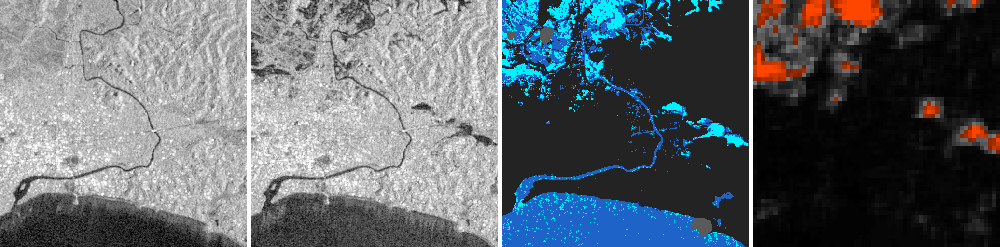
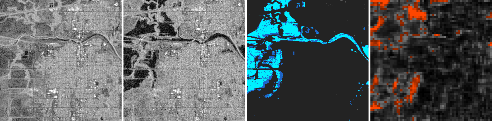
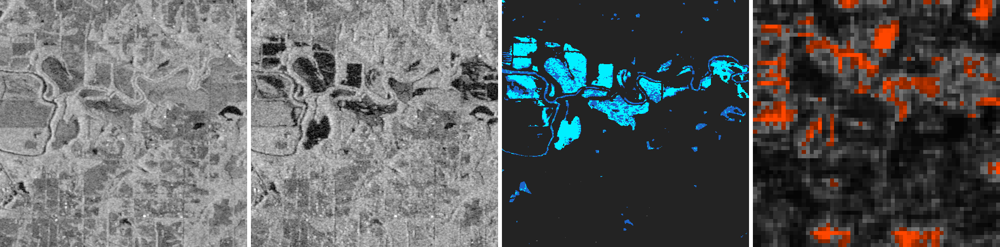
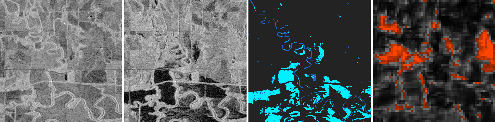
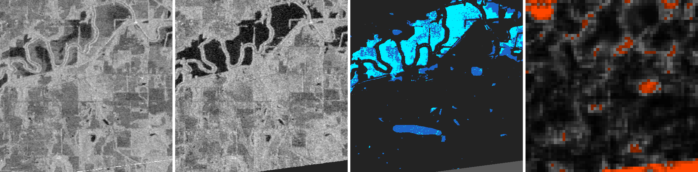
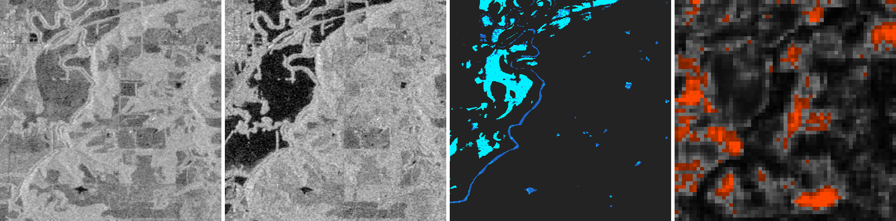
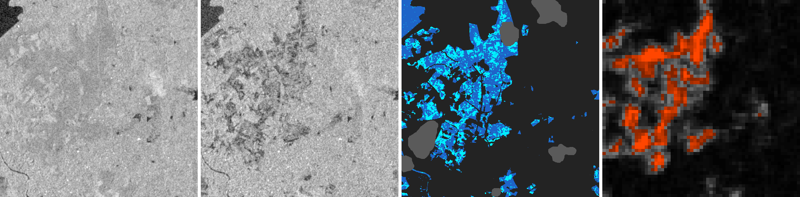
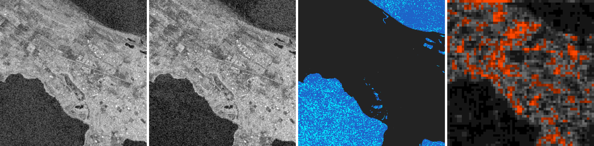

# siam

Zero-dependency C11 Siamese Contrastive (Symmetric InfoNCE / Cosine Distance) engine for self-supervised satellite & SAR image change detection on Netpbm PGM (`P5`/`P2`, 8-bit & 16-bit) imagery.

## Build

```sh
make          # single-threaded
make OMP=1    # multi-threaded (OpenMP)
```

Or compile directly:

```sh
cc -O3 -march=native -Wall -Wextra -Wno-unknown-pragmas siam.c -lm -o siam
```

## Usage

### 1. Train (`-t`)
Train across multiple `<pre.pgm> <post.pgm>` pairs via positional arguments, `-L <list.txt>`, or streamed from `stdin` (`-`):

```sh
paste <(find pgm_floods -name '*_pre.pgm' | sort | head -n 300) \
      <(find pgm_floods -name '*_post.pgm' | sort | head -n 300) \
  | ./siam -t -w flood.w -n 100000 -
```

### 2. Evaluate (`-e`)
Compute label-free Matched vs. Mismatched Tile ROC-AUC across held-out image pairs:

```sh
paste <(find pgm_floods -name '*_pre.pgm' | sort | tail -n 103) \
      <(find pgm_floods -name '*_post.pgm' | sort | tail -n 103) \
  | ./siam -e -w flood.w -
```

```text
siam: evaluated 103 pairs (383263 tiles, stride=8, thresh=0.35)
  matched    (pre_i, post_i): mean=0.1268 med=0.1156 p95=0.2554 alerts=1/103 (1.0%)
  mismatched (pre_i, post_j): mean=0.4045 med=0.4048 p95=0.5860 alerts=103/103 (100.0%)
  separation gap:             +0.2777
  tile ROC-AUC:               0.9811
```

### 3. Inference & Alerting
Follows POSIX `diff(1)` / `cmp(1)` exit conventions (`0` = normal, `1` = anomaly alert triggered, `2` = error):

```sh
./siam -w flood.w -a 0.35 -f 0.05 pre.pgm post.pgm > change_map.pgm || notify_alert
```

---

## Sen1Floods11 ($512\times512$) Ground-Truth Flood Comparisons

Trained for 100,000 steps (`flood.w`) without labels on 300 Sentinel-1 SAR pairs (`0.9811` Matched-vs-Mismatched Tile ROC-AUC across 383,263 held-out tiles). Each 4-panel figure shows:
1. **Panel 1:** Pre-Flood Sentinel-1 SAR ($512\times512$)
2. **Panel 2:** Post-Flood Sentinel-1 SAR ($512\times512$)
3. **Panel 3:** Hand-Labeled Ground-Truth Flood Mask (**dark blue** = permanent ocean/river water, **bright cyan** = newly flooded land)
4. **Panel 4:** `siam` $61\times61$ Cosine-Distance Change Map (**red/orange** = detected flood change)

### `Sri-Lanka_916628` (`0.9881` Flood Change ROC-AUC)


### `USA_170264`


### `USA_1068362`


### `USA_955053`


### `USA_217598`


### `USA_595451`


### `Sri-Lanka_92824`


### `Sri-Lanka_713926`


